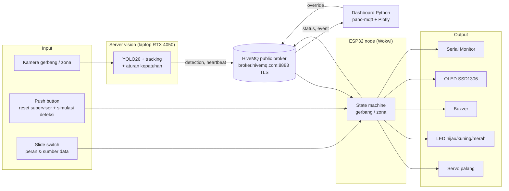
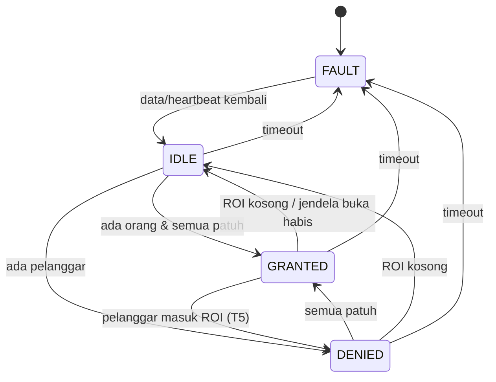
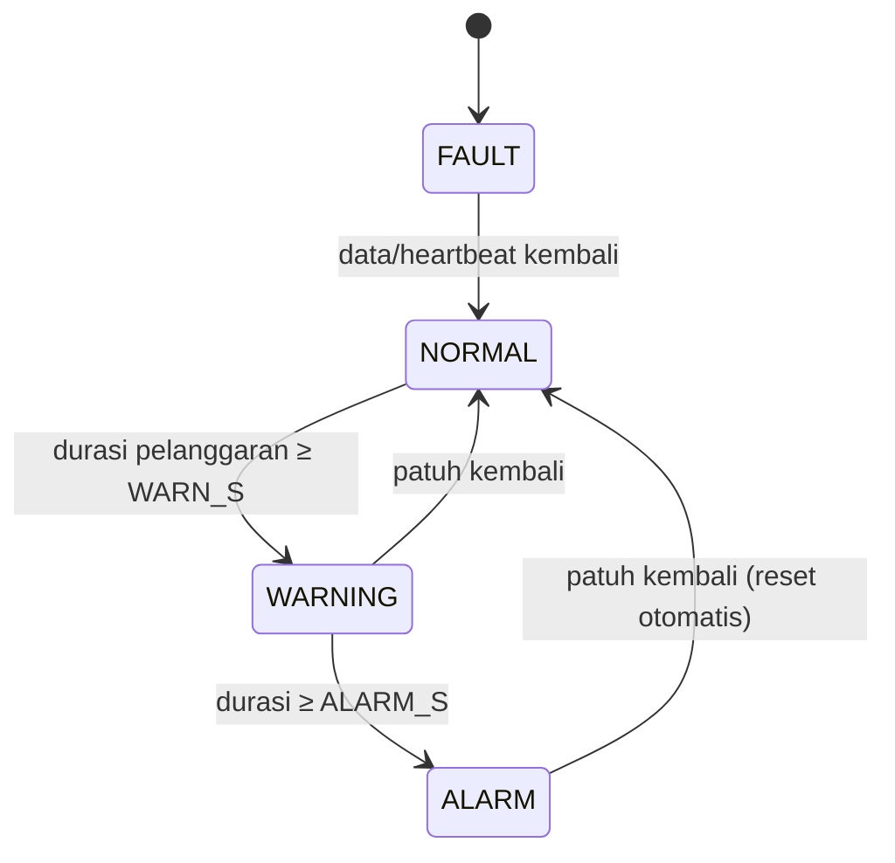

# Design — IRIS

Rancangan dasar (langkah 1). Penanggung jawab hardware/firmware: Christian; integrasi: Naufal.
Nilai yang ditandai *(tuning)* adalah nilai awal dan difinalkan saat pengujian.

## 1. Alur sistem



Hasil deteksi YOLO diperlakukan sebagai **sensor virtual** yang masuk lewat MQTT. Wokwi tidak bisa menjalankan
kamera/YOLO, jadi pada mode uji (TEST) hasil deteksi disimulasikan dengan push button.

## 2. Komponen dan alasan pemilihan

| Komponen (part Wokwi) | Jumlah | Fungsi | Alasan teknis |
|---|---|---|---|
| ESP32 DevKit C v4 (`board-esp32-devkit-c-v4`) | 1 | Controller, logic, WiFi/MQTT | Wajib dari tugas; WiFi bawaan untuk MQTT; GPIO cukup untuk semua I/O |
| Servo SG90 (`wokwi-servo`) | 1 | Palang gerbang (0° tutup, 90° buka) | Aktuasi mekanis yang terlihat jelas di demo; dikendalikan PWM 50 Hz |
| LED hijau, kuning, merah (`wokwi-led`) + resistor 220 Ω | 3 + 3 | Status patuh / peringatan & gangguan / pelanggaran | Indikator murah, terbaca dari jauh; resistor membatasi arus ±(3,3−2)/220 ≈ 6 mA |
| Buzzer piezo (`wokwi-buzzer`) | 1 | Alarm audio | Peringatan yang tetap terdengar walau pekerja tidak melihat lampu; nada diatur PWM (LEDC) |
| OLED SSD1306 128×64 I2C (`board-ssd1306`) | 1 | Menampilkan status dan APD yang kurang | Informasi spesifik untuk pekerja ("HELM TIDAK TERDETEKSI"); I2C hanya butuh 2 pin |
| Push button (`wokwi-pushbutton`) | 4 | `RESET` supervisor; `PERSON`, `HELMET`, `VEST` untuk simulasi deteksi | Input fisik; satu-satunya input yang bisa diotomatisasi oleh scenario `wokwi-cli` (`set-control pressed`) |
| Slide switch (`wokwi-slide-switch`) | 2 | `ROLE` (GATE/ZONE), `SOURCE` (LIVE/TEST) | Pilihan mode yang terlihat di rangkaian; satu rangkaian bisa mendemokan kedua mode |
| Label teks (`wokwi-text`) | 4 | Keterangan INPUT/OUTPUT dan fungsi slide switch | Hanya visual di Wokwi, agar rangkaian mudah dibaca |
| Kamera (di luar Wokwi) | 1/titik | Sumber citra server vision | Komponen utama deteksi APD |

Catatan implementasi nyata (stage 3): tombol `PERSON/HELMET/VEST` hanya ada untuk mode uji; node lapangan cukup
punya `RESET`. Satu ESP32 per titik (gerbang/zona) dengan `ROLE` tetap. Servo diberi catu 5 V terpisah, dan buzzer
memakai modul atau transistor driver.

## 3. Pemetaan GPIO

Status: draft v2 (2026-10-29), lulus uji wokwi-cli dan dicek visual di editor wokwi.com; menunggu review Christian.

Prinsip tata letak: **input di sisi kiri board, output di sisi kanan**, dan urutan komponen di diagram mengikuti
urutan pin dari atas ke bawah, sehingga kabel tidak saling silang (lihat `firmware/diagram.json`).

| GPIO | Sisi | Arah | Terhubung ke | Catatan |
|---|---|---|---|---|
| 32 | kiri | Input, pull-up internal | Slide switch `ROLE` (kaki tengah; kaki kiri ke GND) | Kiri = LOW = GATE, kanan (lepas) = HIGH = ZONE |
| 33 | kiri | Input, pull-up internal | Slide switch `SOURCE` | Kiri = LOW = LIVE (MQTT), kanan = HIGH = TEST (tombol) |
| 25 | kiri | Input, pull-up internal | Tombol `PERSON` → GND | Aktif LOW, toggle (mode TEST) |
| 26 | kiri | Input, pull-up internal | Tombol `HELMET` → GND | Aktif LOW, toggle (mode TEST) |
| 27 | kiri | Input, pull-up internal | Tombol `VEST` → GND | Aktif LOW, toggle (mode TEST) |
| 14 | kiri | Input, pull-up internal | Tombol `RESET` → GND | Aktif LOW; reset/ack alarm |
| 23 | kanan | Output (PWM) | Buzzer (+) | `ledcWriteTone` |
| 22 | kanan | I2C SDA | OLED SDA | I2C bisa di pin mana pun via `Wire.begin(SDA, SCL)` |
| 21 | kanan | I2C SCL | OLED SCL | |
| 19 | kanan | Output (PWM) | Servo PWM | LEDC 50 Hz via ESP32Servo |
| 18 | kanan | Output | 220 Ω → LED hijau → GND | |
| 17 | kanan | Output | 220 Ω → LED kuning → GND | |
| 16 | kanan | Output | 220 Ω → LED merah → GND | |

Pin yang **dihindari**: 0, 2, 5, 12, 15 (strapping), 6–11 (flash), 1/3 (UART Serial Monitor), 34–39 (input-only tanpa
pull-up internal). GPIO 16/17 aman pada modul ESP32-WROOM (DevKitC v4); pada modul WROVER keduanya dipakai PSRAM.

Perubahan dari draft v1: slide switch pindah dari GPIO 34/35 (perlu kabel 3V3) ke 32/33 dengan pull-up internal
(hanya perlu kabel GND), dan semua output dipindah ke sisi kanan agar wiring rapi.

**Power & ground:** semua komponen berbagi GND ESP32 (bus GND di kiri dan trunk bawah ke GND.1; buzzer ke GND.2,
OLED ke GND.3). OLED dari 3V3. Servo V+ dari pin 5V (di Wokwi; pada hardware nyata dari catu 5 V terpisah dengan ground
bersama).

## 4. State machine

Evaluasi dilakukan setiap loop dari **snapshot deteksi** terakhir: `person_count`, daftar pelanggar, APD yang kurang,
dan umur snapshot. Pada `SOURCE=LIVE` snapshot berasal dari MQTT; pada `SOURCE=TEST` dari tombol.

### 4.1 Mode gerbang



| State | Palang | LED | Buzzer | OLED |
|---|---|---|---|---|
| `FAULT` | tertutup (terkunci) | kuning berkedip | — | "VISION OFFLINE" |
| `IDLE` | tertutup | — | — | "SIAP" |
| `GRANTED` | **terbuka** maks `OPEN_WINDOW_MS` | hijau | 1 bip pendek | "SILAKAN MASUK" |
| `DENIED` | tertutup | merah | bip berulang (bisa di-ack `RESET`) | APD yang kurang |

- Palang terbuka hanya jika **semua** orang di ROI patuh. Satu pelanggar → `DENIED`.
- Setelah `OPEN_WINDOW_MS` palang menutup (`IDLE`); jika antrean masih patuh, dibuka lagi pada evaluasi berikutnya.

### 4.2 Mode zona (monitoring)



| State | LED | Buzzer | OLED | Event MQTT |
|---|---|---|---|---|
| `NORMAL` | hijau | — | "ZONA AMAN" (atau hitung mundur bila pelanggaran < `WARN_S`, diabaikan) | — |
| `WARNING` | kuning | — | APD yang kurang + durasi | `warning` |
| `ALARM` | merah | bip berulang (bisa di-ack `RESET`) | APD yang kurang + durasi | `alarm` |
| `FAULT` | kuning berkedip | — | "VISION OFFLINE" | `fault` |

Durasi pelanggaran: utamakan `violation_s` per orang dari server (berbasis tracking ID); jika tidak ada, ESP32
menghitung sendiri sejak pelanggar pertama terlihat (fallback durasi level frame).

### 4.3 Konstanta konfigurasi (`firmware/src/config.h`)

| Nama | Nilai awal | Arti |
|---|---|---|
| `FAILSAFE_TIMEOUT_MS` | 5000 *(tuning)* | Tanpa heartbeat/deteksi selama ini → `FAULT` |
| `OPEN_WINDOW_MS` | 5000 *(tuning)* | Lama palang terbuka per izin |
| `GATE_REARM_MS` | 2000 *(tuning)* | Jeda palang tertutup sebelum boleh dibuka lagi |
| `ZONE_WARN_S` | 3 *(tuning)* | Pelanggaran lebih singkat dari ini diabaikan |
| `ZONE_ALARM_S` | 8 *(tuning)* | Batas eskalasi ke alarm |
| `STATUS_PERIOD_MS` | 5000 | Publikasi status periodik |

## 5. MQTT (final irisan 2)

Broker `broker.hivemq.com:8883` (TLS). ESP32 memverifikasi sertifikat server dengan **Amazon Root CA 1**
(`firmware/src/ca_cert.h`; rantai: `Amazon RSA 2048 M04` → `Amazon Root CA 1`), bukan `setInsecure()`.
Prefix `<prefix>` = `sic8-montblanc/iris`. Semua payload JSON dan punya `ts` (detik Unix; ESP32 memakai NTP dan
mengirim `0` sebelum jam tersinkron).

| Topic | Arah | QoS / retain | Payload |
|---|---|---|---|
| `<prefix>/<node>/detection` | server → ESP32, dashboard | 0 | `{"ts":1793210995.2,"person_count":2,"persons":[{"id":1,"helmet":true,"vest":true,"violation_s":0.0},{"id":2,"helmet":false,"vest":true,"violation_s":4.5}],"violators":[2]}` |
| `<prefix>/<node>/status` | ESP32 → dashboard | 0 / **retain** | `{"ts":...,"node":"gate1","mode":"gate","source":"live","state":"DENIED","gate":"closed","missing":["helmet"],"person_count":2,"violation_s":0.0}` |
| `<prefix>/<node>/event` | ESP32 → dashboard | 0 | `{"ts":...,"node":"gate1","type":"denied","level":2,"missing":["helmet"],"person_count":2,"duration_s":0.0}` |
| `<prefix>/<node>/override` | dashboard/supervisor → ESP32 | 1 | `{"cmd":"reset"}` |
| `<prefix>/server/heartbeat` | server → ESP32 | 0 | `{"ts":...,"fps":24.5,"source":"vision"}` |

- `<node>`: `gate1`, `zoneA`. `type` event: `granted`, `denied`, `warning`, `alarm`, `cleared`, `fault`, `recovered`;
  `level`: 0 info, 1 peringatan, 2 pelanggaran, 3 gangguan.
- Server mengirim `detection` ±2 Hz dan `heartbeat` 1 Hz. ESP32 masuk `FAULT` bila salah satunya berhenti
  > `FAILSAFE_TIMEOUT_MS`.
- ESP32 publish `status` saat state/APD berubah dan tiap `STATUS_PERIOD_MS`. *Last Will* broker:
  `{"node":"gate1","state":"OFFLINE"}` (retain) jika ESP32 putus tidak wajar.
- ESP32 memakai PubSubClient, yang hanya bisa publish QoS 0; karena itu `event` QoS 0.
- `vision/iris_mqtt.py` = modul koneksi Python bersama; `vision/sim_publisher.py` = simulator server vision.

**Keterbatasan diketahui:** saat (re)connect TLS, `loop()` tertahan beberapa detik (handshake dibatasi 8 s). Selama itu
aktuator mempertahankan state terakhir. Pada mode LIVE durasi pelanggaran dihitung server, jadi timer zona tidak
terpengaruh; pada mode TEST timer lokal ikut berjalan.

## 6. Dashboard (`dashboard/`)

Plotly Dash, berjalan lokal di http://127.0.0.1:8050, refresh tiap 1 detik. `store.py` subscribe
`<prefix>/+/status`, `<prefix>/+/event`, `<prefix>/+/detection`, dan heartbeat; event dicatat ke
`dashboard/data/events.csv`.

| Bagian | Isi | Sumber data |
|---|---|---|
| Indikator koneksi | Broker terhubung; server vision online (heartbeat ≤ 5 s) | koneksi paho, heartbeat |
| Stat tile | Compliance rate sesi, jumlah pelanggaran (denied+alarm), izin masuk (granted), FPS server vision | detection, event, heartbeat |
| Kartu node `gate1`, `zoneA` | State (warna status + ikon + label), palang/durasi, jumlah orang, APD kurang, umur data; tombol **Reset alarm** → `override` | status |
| Grafik compliance rate | % orang patuh per 30 s, 10 menit terakhir (satu garis) | detection |
| Grafik pelanggaran per waktu | Event denied/alarm per 30 s, ditumpuk menurut APD kurang (helm, rompi) | event |
| Tabel event terbaru | 12 event terakhir (juga berfungsi sebagai versi tabel grafik) | event |

Warna: palet status (good/warning/serious/critical) hanya untuk state, selalu bersama ikon dan label; seri grafik
memakai warna kategorikal biru/oranye (lolos validator palet: CVD ΔE 24,7, kontras ≥ 3:1).

## 7. Format log Serial

Satu baris per kejadian, diawali tag:

```
[BOOT] IRIS node=gate1 role=GATE source=TEST
[INPUT] person=1 helmet=1 vest=0
[STATE] IDLE -> DENIED missing=vest
[ACT] servo=0 led=RED buzzer=ON
[NET] wifi connected ip=10.10.0.2          (irisan 2)
[MQTT] rx detection person_count=1 violators=1   (irisan 2)
```
